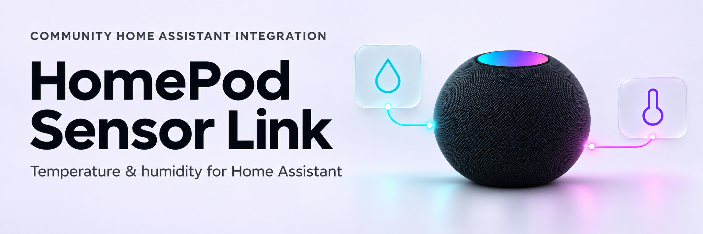

<picture>
  <source media="(prefers-color-scheme: dark)" srcset="docs/images/readme-banner-dark.png">
  <source media="(prefers-color-scheme: light)" srcset="docs/images/readme-banner-light.png">
  
</picture>

<p align="center">
  <a href="https://github.com/barneyonline/ha-homepod-sensor-link/releases/latest"></a>
  <a href="https://github.com/barneyonline/ha-homepod-sensor-link/wiki/Known-Limitations"></a>
  <a href="https://github.com/barneyonline/ha-homepod-sensor-link/wiki/Getting-Started"></a>
  <a href="#get-started"></a>
</p>

<p align="center">Monitor temperature and humidity. Keep your HomePod sensor connection healthy.</p>

<p align="center">
  <a href="#get-started">Install</a> ·
  <a href="#key-features">Features</a> ·
  <a href="https://github.com/barneyonline/ha-homepod-sensor-link/wiki">Documentation</a> ·
  <a href="https://github.com/barneyonline/ha-homepod-sensor-link/blob/main/CONTRIBUTING.md">Contribute</a>
</p>

> [!IMPORTANT]
> HomePod Sensor Link is an independent community project with no affiliation to Apple. **Experimental:** controller-key extraction, device setup and pairing recovery still require real-device verification. Review the [known limitations](https://github.com/barneyonline/ha-homepod-sensor-link/wiki/Known-Limitations) before installing. No HACS listing is claimed.

## Key features

- **Climate sensors:** temperature and humidity from one or more selected HomePods.
- **Friendly device names:** use uniquely matched AirPlay names during discovery and integration reloads. Manual names stay in place; unavailable or ambiguous matches keep the current name.
- **Guided setup:** discover devices, import authorised controller credentials, or adopt existing native HomeKit sensors without changing their entities or history.
- **Connection monitoring:** fresh authenticated checks, sensor freshness, diagnostics and administrator-access audits.
- **Optional recovery:** on by default per device, with pinned identities, pairing-preservation checks and persisted repair limits.
- **Device management and privacy:** resume partial setup, retry or cancel work, and automatically remove owned credentials and recovery history when a device is removed.

## Get started

<!-- ha-marketplace:exclude-start -->
[](https://my.home-assistant.io/redirect/marketplace_repository/?owner=barneyonline&repository=ha-homepod-sensor-link&category=integration)

1. Read the [credential prerequisite and extraction guide](https://github.com/barneyonline/ha-homepod-sensor-link/wiki/Credential-Extraction). A controller key needs its controller ID and accessory public-key pin; a HomeKit setup code is insufficient.
2. On **HA 2026.11+**, use the button above, or open **Settings → Marketplace → Add from link** and enter `https://github.com/barneyonline/ha-homepod-sensor-link`. Connect GitHub when prompted and add it as an **Integration**.
3. Open **HomePod Sensor Link**, select **Install**, review the [latest release](https://github.com/barneyonline/ha-homepod-sensor-link/releases/latest), and confirm. Follow any restart prompt. Choose a tagged release; `main`/default-branch versions are development builds.
4. Continue the setup prompt, or open **Settings → Devices & services → Add integration → HomePod Sensor Link**. Select your devices and recovery policy, then choose **Paste a CSV or JSON export** or **Enter controller credentials** in the standard Home Assistant setup dialog. Open an export in a text editor to copy its contents; file upload is not required.

See the [setup guide](https://github.com/barneyonline/ha-homepod-sensor-link/wiki/Getting-Started#installation) for detailed installation steps and [HA’s Marketplace instructions](https://www.home-assistant.io/integrations/marketplace/#custom-repositories) for adding custom repositories.
<!-- ha-marketplace:exclude-end -->

Requires **Home Assistant 2026.11.0+** (Python **3.14+**).

See the [Wiki](https://github.com/barneyonline/ha-homepod-sensor-link/wiki) for [setup](https://github.com/barneyonline/ha-homepod-sensor-link/wiki/Getting-Started), [using the integration](https://github.com/barneyonline/ha-homepod-sensor-link/wiki/Using-the-Integration), [automation examples](https://github.com/barneyonline/ha-homepod-sensor-link/wiki/Automation-Examples) and [troubleshooting](https://github.com/barneyonline/ha-homepod-sensor-link/wiki/Troubleshooting-and-Support).

Credential import requires a local HA administrator. HTTP import is accepted but does not encrypt keys in transit. Never share controller keys, exports or HA storage in issues. [Security guidance](https://github.com/barneyonline/ha-homepod-sensor-link/wiki/Security).

<details>
<summary>Setup, recovery and removal details</summary>

- Credential import accepts selected HAP CSV rows, a single JSON credential record, `controllers`/`accessories` JSON bundles, and aiohomekit JSON dictionaries keyed by accessory ID. Dictionary records may include historical network fields. Literal address hints trigger directed DNS-SD discovery through temporary unicast reply sockets when multicast misses a HomePod; fresh advertisements supply current ports and imported keys supply identity pins. Use Reconfigure → Import pairing export to find missing devices, then review the newly discovered devices before setup.
- Setup actively browses for sensor services for five seconds, then resolves their current endpoints. A HomePod that does not advertise its sensor service may remain absent even when its AirPlay player is visible.
- If no HomePods are available to add, setup explains local discovery requirements and offers **Search again** or **Import pairing export**. Search again keeps your current import; Import pairing export lets you replace it with corrected address hints. HomePods already managed by this integration are hidden. A failed search is reported separately so you can check connectivity and retry.

- New devices use a dedicated User controller; existing native HomeKit sensor entities and history remain unchanged.
- Recovery is optional per device and requires verified administrator credentials. Network/discovery failures never authorise pairing changes.
- Use **Reconfigure → Manage existing devices** to choose a HomePod, open its action menu and review an action before submitting it. The menu offers enable or disable recovery according to that HomePod’s current setting. Removal requires an explicit confirmation.
- Removing a device deletes its owned credentials and recovery history. It does not revoke on-device pairings or delete native HomeKit entries/history.
- No legacy `homepod_recovery` transition or storage migration is provided.

Read the [setup guide](https://github.com/barneyonline/ha-homepod-sensor-link/wiki/Getting-Started) and [known limitations](https://github.com/barneyonline/ha-homepod-sensor-link/wiki/Known-Limitations) for the full lifecycle and human prerequisites.

</details>

<details>
<summary>Development and validation</summary>

```sh
sh scripts/validate.sh
python3 scripts/package.py --output /tmp/homepod-sensor-link-local.zip
```

Automated tests run on HA **2026.11.0** with aiohomekit **4.0.1**. Validation requires **100% Python statements/branches per integration module**, **100% JavaScript lines/branches/functions**, strict typing, hassfest, Ruff and repository/wiki checks. Codecov reports the Python integration coverage; JavaScript is gated separately.

See [contributing](https://github.com/barneyonline/ha-homepod-sensor-link/blob/main/CONTRIBUTING.md), [development](https://github.com/barneyonline/ha-homepod-sensor-link/wiki/Development-Environment), [validation evidence](https://github.com/barneyonline/ha-homepod-sensor-link/actions/workflows/validate.yml) and the [Platinum engineering target](https://github.com/barneyonline/ha-homepod-sensor-link/blob/main/CONTRIBUTING.md#quality-checks). A target is not an awarded Home Assistant quality tier; extraction and real-device verification remain outstanding.

</details>

[](https://github.com/barneyonline/ha-homepod-sensor-link/actions/workflows/validate.yml)
[](https://github.com/barneyonline/ha-homepod-sensor-link/actions/workflows/hacs.yml)
[](https://github.com/barneyonline/ha-homepod-sensor-link/actions/workflows/hassfest.yml)
[](https://github.com/barneyonline/ha-homepod-sensor-link/actions/workflows/codespell.yml)
[](https://app.codecov.io/gh/barneyonline/ha-homepod-sensor-link)
[](https://github.com/barneyonline/ha-homepod-sensor-link/blob/main/CONTRIBUTING.md#quality-checks)
[](https://github.com/barneyonline/ha-homepod-sensor-link/stargazers)
[](LICENSE)
[](https://github.com/barneyonline/ha-homepod-sensor-link/issues)

GPL-3.0 licensed. See [LICENSE](LICENSE).
