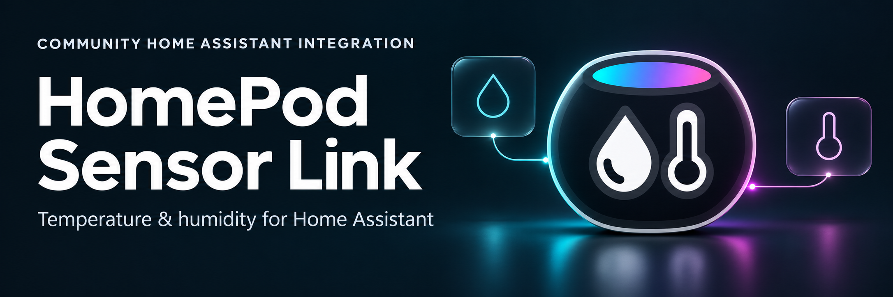
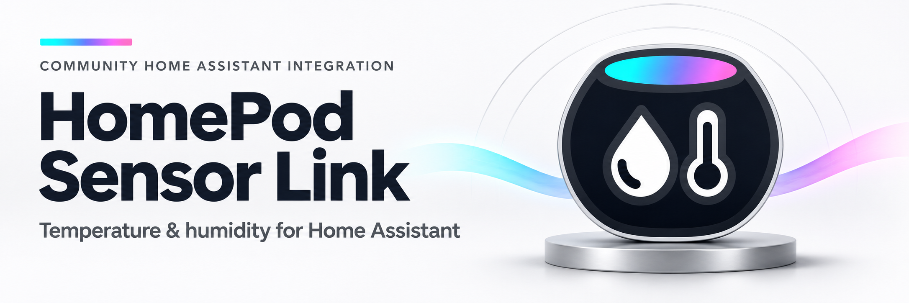
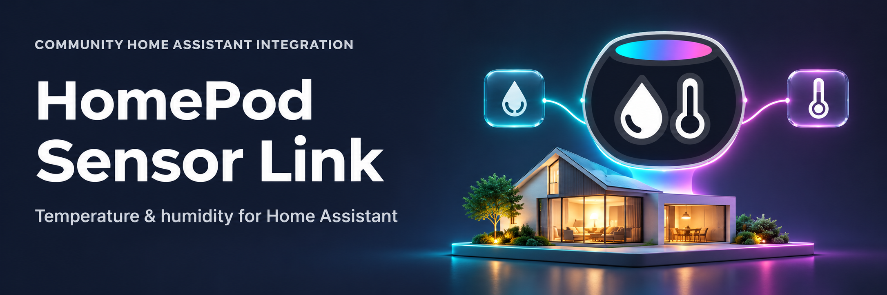

# HomePod Sensor Link — README banner options

Three alternatives based on the selected HomePod Midnight Climate Pod. All use the left-title/right-illustration composition seen in the local Enphase Energy, Energy Planner and Groq integration READMEs. The built-in image-generation tool produced each banner with the selected icon and one existing banner as references; outputs are preserved unchanged. Full specifications are in [PROMPTS.md](PROMPTS.md).

## 1. Midnight Glass

Dark glass sensor cards and restrained cyan/pink lighting, with the brand icon as the hero. Closest to Groq's visual finish and the strongest direct connection to the selected icon.

## 2. Silver Studio

Light silver studio, strong dark text and a prominent midnight emblem. Enphase-inspired clarity with a subtle cyan/pink ribbon.

## 3. Connected Home

An illuminated home, floating brand icon and linked temperature/humidity symbols. Closest to the architectural illustration style used by Energy Planner and Groq.

Each image is a 2172 × 724 opaque PNG, exactly 3:1, suitable for display at 1200 × 400 CSS pixels. The text was visually checked for the correct integration name and subtitle. The original icon artwork is interpreted within each illustration; the production icon files are unchanged.

These are selectable concepts, not yet referenced by the main README or included in install archives. The current SVG banner and all prior assets remain in place. Once a direction is selected, a matched light/dark pair can be prepared for the README's `picture` element, following the other integrations. No badges, release status or quality awards are claimed in the artwork.
