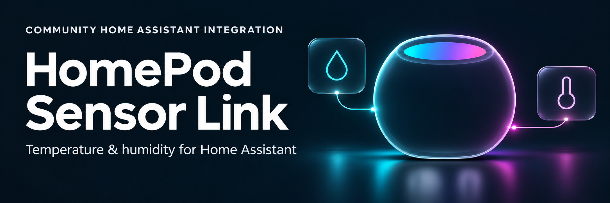
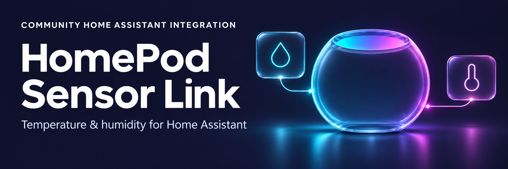
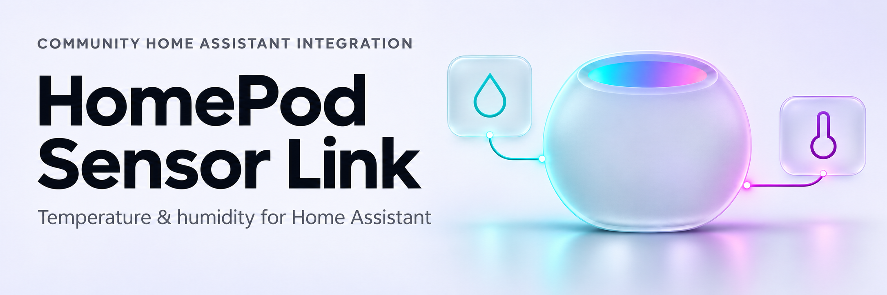
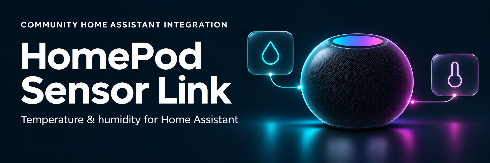
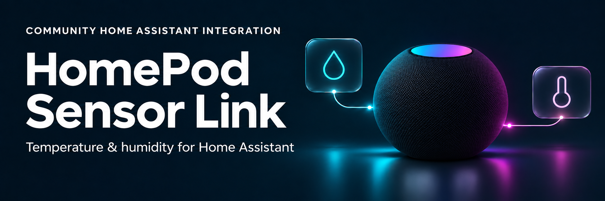

# Midnight Glass — plain glass HomePod variants

Revision 5 was selected for the active dark README banner. A matching light version is now used by the main README's theme-aware picture element; the files are `docs/images/readme-banner-dark.png` and `docs/images/readme-banner-light.png`.

Three refinements of the original Midnight Glass banner. The temperature and humidity glyphs have been removed from the HomePod body; the two external sensor tiles and their connectors remain. The pod now shares the glass treatment of those tiles. Typography and the left-title/right-illustration layout are retained.

## 1. Smoked Midnight

Smoked glass and restrained cyan/violet edge lighting on the original midnight background.

## 2. Crystal Indigo

Clearer blue-violet glass with stronger refraction and more visible depth on an indigo background.

## 3. Frosted Light

Frosted silver glass on a pale background, dark typography, and contrasting cyan/violet sensor symbols.

## 4. Smoked Midnight — rounded speaker revision

A more physical HomePod mini-like speaker replaces the flat glass silhouette: a curved spherical body, inset top touch surface, dark speaker texture, directional highlights and a contact shadow. The external glass sensor tiles, midnight palette and text remain. The speaker front has no sensor glyphs.

## 5. Smoked Midnight — no transparent border

The transparent outer shell and hard rim are removed from the rounded speaker. Its opaque mesh body defines the silhouette, with soft cyan/violet lighting on the material. The external glass sensor tiles remain.

All five are 2172 × 724 opaque PNGs (3:1), suitable for display at 1200 × 400 CSS pixels. Generated with the built-in image-generation tool; the [full prompts](PROMPTS.md) are retained. The exported images were visually checked for correct text, no sensor glyphs on the HomePod front and both external sensor symbols. These source options and the packaged integration brand icons are preserved; revision 5 is also copied to the active dark README banner.
