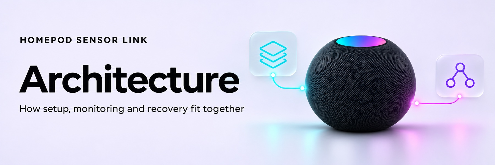

<!-- Generated by scripts/build_wiki.py; edit its source page. -->

<picture>
  <source media="(prefers-color-scheme: dark)" srcset="../docs/images/wiki/Architecture-dark.jpg">
  <source media="(prefers-color-scheme: light)" srcset="../docs/images/wiki/Architecture-light.jpg">
  
</picture>

# Architecture

`homepod_sensor_link` is the only packaged integration. One config entry manages per-device private records and recovery policies. There is no legacy wrapper, transition or storage migration.

## Layers

| Module | Responsibility |
|---|---|
| `config_flow.py` | Discovery, per-device recovery defaults, import handoff, cancellable progress and device management |
| `ui.py`, `frontend/import.js` | Local administrator-only CSV/JSON/field import, bounded memory, user/flow-bound expiring grants |
| `importer.py` | Strict export parsing, derived public-key validation, exact accessory-ID spelling |
| `vault.py`, `secure_storage.py` | Owner-checked private journal, atomic drained writes, cancellation checkpoints and automatic purge |
| `provisioning.py` | Read-only identity matching and persisted-before-write dedicated User commissioning |
| `backend.py` | Fresh HAP sessions, pinned identity/private-key checks, add-only preservation, cleanup classification |
| `engine.py`, `audit.py` | Per-device recovery policy, grace, rolling limits, persisted reloads and administrator audits |
| `__init__.py` | Setup, globally registered actions, unload and explicit removal |
| `coordinator.py`, `entity.py`, `models.py` | Typed runtime, shared entity, startup probes, dynamic selected-device publication and private/state lifecycle |
| `repairs.py` | Public Repairs API adaptation for HA 2026.10/2026.11 |
| `sensor.py` | Integration-owned measurements for new devices; separate diagnostic devices for all records |

Existing native `homekit_controller` measurement entries/entities are never recreated, migrated, removed or assigned to this integration. Native ownership is retained on adoption. New devices use HA’s supported entity platform rather than a fabricated native import API.

## Input boundary

A dedicated HA panel sends the selected export directly to an authenticated view. The server checks the real authenticated user, administrator permission, HA-resolved local peer and non-Cloud context **before reading body bytes**. It never trusts a client-provided admin flag or parses forwarding headers itself. HTTP is accepted without an acknowledgement. The browser stores no credential payload in local storage or URLs; session grants are short-lived, bound to the owner/flow, and carried in the URL fragment rather than server request paths.

The standard global file-upload endpoint is not used. Uploads are capped at 128 KiB with a streaming limit and timeout, independent of HA’s body-size defaults. Raw exports remain in memory and are removed on consumption, expiration, abort and shutdown. No generic temporary upload file contains an entire keychain export.

The parser supports typed JSON, a single complete pairing record, and selected HAP CSV rows. Unknown groups, mismatched key pairs, conflicting records and binary placeholders fail with a controlled error. Source identities are tried at most three per selected device. Only read-only probes run during matching. Discovery endpoints are untrusted hints; Pair Verify checks the supplied accessory pin before trusting a peer. Canonical IDs deduplicate; exact exported ID spelling is retained in the actual HAP pairing dictionary.

## Durable onboarding

The private journal is `.storage/homepod_sensor_link/data.json`, in a process-owned 0700 directory with a 0600 regular file. It contains per-device controller credentials, administrator credentials when needed, public pins, transaction phases and recovery state in one atomic document. Credentials and cooldown/blocked/pending history cannot be independently reset by losing a separate state file. Public identity/admin pins are mirrored in the integration’s public config-entry data; private key material never enters flow results or core config data. The journal uses no-follow descriptor reads and atomic replace/fsync writes. Cancellation drains a committed write before releasing the store lock, preventing a late executor from recreating deleted credentials.

Each new device gets one generated User controller identity, saved before any pairing operation. It is reused across retries and restarts. Phases distinguish prepared, needs-credentials, write-uncertain, accepted, verified, active and blocked outcomes. Initial writes are authorised only in the HA process that completed the guided flow. A new boot can perform read-only authentication; further writes require Resume. Cancellation stops in-flight setup and persists a pause without replacing the saved key.

Before adding, authenticated administrator access and the complete pairing table are checked. Only the absent pinned HA row is added, with User permissions for new devices. Every existing row must remain unchanged. The original rows and expected HA row are checkpointed in the private journal before the write. A lost reply retains that checkpoint across restart; subsequent fresh sensor authentication must also verify the preserved table before clearing it or reporting success. A present row that rejects the saved key or has changed permission blocks further writes. An ambiguous response remains journalled; it does not cause blind re-addition. Provisioning attempt timestamps feed the same rolling per-device limits used by recovery.

Successful and pending devices coexist in one entry. New measurement values are published only after fresh characteristic reads; setup completes only after both actual HA sensor entities report those samples. This publication checkpoint controls deletion of administrator credentials for completed monitoring-only devices. Recovery-on devices retain their verified administrator identity. Existing native adoption additionally verifies loaded state and recent finite temperature/humidity reports.

## Recovery and lifecycle

An integration-owned coordinator listener keeps checks active even when all entity listeners are disabled. Independent device probes run concurrently. The five-minute engine retains three confirmed authentication failures spanning ten minutes, ten-minute startup grace, one repair attempt per hour and three per rolling day. Pending reload/publication work is persisted and retries at most three times per rolling hour. An accepted pairing is not re-added because entity publication failed. Network/discovery and cleanup-only errors cannot authorise repair. Regular restart preserves state; removal deliberately resets it.

A single runtime owner is claimed before awaits and released only after successful shutdown. An active `homepod_recovery` entry is a conflict—not a migration opportunity. Stop gates protect queued checks/audits. The competing-engine predicate is checked during operation and immediately before add-pairing; a conflict pauses this engine and clears stale authentication streak evidence without deleting rate-limit history. Unknown or corrupt persisted cooldown/blocked state fails closed. The v1.1.1 aiohomekit shutdown regression remains: a repeated connector failure cannot replace the primary authentication/safety classification or cancellation, and remaining transports are closed.

Actions remain registered when entries unload and resolve the active runtime at call time. Fresh read-only preflight runs before platform creation: an all-network failure retries setup, while per-device authentication/pin failures stay isolated without permitting writes. Reauthentication re-imports the same pinned identities and retains repair history. Explicitly prepared new devices update the running coordinator/entity set without reloading healthy peers. HA 2026.10 Repairs lack entry linkage; the public adapter omits only that unsupported argument, and explicit cleanup applies on both versions. Actionable issues survive ordinary unload and clear on resolution/removal.

Per-device removal first stops that device’s work, deletes its private record/history and public references, and lets HA remove the integration-owned diagnostic/measurement device. Integration removal stops work, revokes pending imports/flows and automatically removes all owned files and recovery state. A delayed cancelled-flow checkpoint cannot recreate an empty store after purge. Cleanup never follows a symlink into foreign data, changes native entries, revokes an accessory pairing or deletes unrelated storage. A registry device still referenced by a foreign entity is retained; only our entities and private state are deleted. Unload/reload alone preserves data.

## Evidence

Synthetic tests exercise real HA classes and entity publication with networking disabled. No device/backup/keychain proof has run. Hardware and extraction-format verification remain release/support gates. Static API research is documented in `UI_RESEARCH.md`; current product policy is this document and the final requirements checklist.
