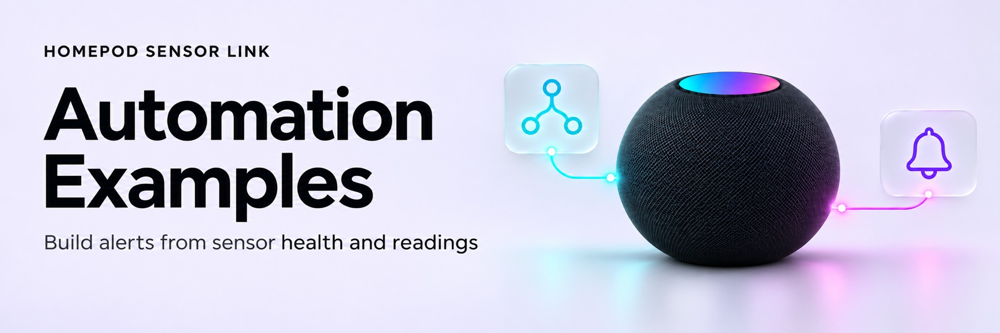

<!-- Generated by scripts/build_wiki.py; edit its source page. -->

<picture>
  <source media="(prefers-color-scheme: dark)" srcset="../docs/images/wiki/Automation-Examples-dark.jpg">
  <source media="(prefers-color-scheme: light)" srcset="../docs/images/wiki/Automation-Examples-light.jpg">
  
</picture>

# Automation examples

Choose your entities with Home Assistant’s UI rather than copying household-specific IDs. No credentials or controller identifiers belong in an automation.

## Alert when checks stop

The repository includes `monitoring/heartbeat-watchdog.yaml`, a blueprint with an entity selector. To use it after installation has been separately authorised:

1. Copy that file into your HA configuration’s `blueprints/automation/homepod_sensor_link/` directory using your normal supported file-management process.
2. Reload automations, create an automation from **HomePod Sensor Link heartbeat**, and select this integration’s sensor-access diagnostic entities.
3. Save the automation. It creates a persistent notification after no completed check has been reported for fifteen minutes, and dismisses it once checks resume.

The watchdog has a fifteen-minute automation startup grace. It does not perform pairing repair, restart HA or require a device/household mapping. A failed check still updates the heartbeat; use the diagnostic status to investigate access failures separately. See [using the integration](Using-the-Integration.md).

## Alert when a measurement is unavailable

In the automation editor, add a state trigger, select a temperature or humidity entity, set the destination state to `unavailable`, and set a duration of fifteen minutes. Add your preferred notification action. Use a separate recovery notification if you want to be told when a numeric state returns.

This catches unavailable measurements; it does not prove that a constant numeric value is fresh. Avoid automatic recovery loops built from entity availability. The integration already applies authenticated checks, startup grace and rolling repair limits.
