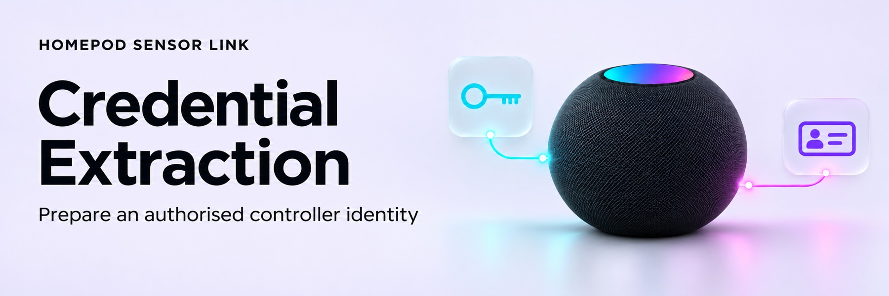

<!-- Generated by scripts/build_wiki.py; edit its source page. -->

<picture>
  <source media="(prefers-color-scheme: dark)" srcset="../docs/images/wiki/Credential-Extraction-dark.jpg">
  <source media="(prefers-color-scheme: light)" srcset="../docs/images/wiki/Credential-Extraction-light.jpg">
  
</picture>

# Controller-key extraction

**Status:** source-reviewed candidate; real-backup and HomePod verification remain outstanding. This integration does not extract credentials automatically.

## Choose your route

| Starting point | Route |
|---|---|
| iPhone/iPad | Create an encrypted backup, then export selected records on a Mac running macOS 14+. |
| Existing authorised macOS export | Check its fields below, then import into HA. |
| Mac only, without an export | No verified direct extraction procedure; see the macOS-only boundary. |

You need a trusted administrator controller identity. A HomeKit QR/setup code cannot replace it; HA verifies administrator permission.

## iOS: create an encrypted backup

1. Open **Home** on your iPhone/iPad and confirm access to the intended HomePods.
2. Connect it to your Mac by cable. Unlock it and complete the normal **Trust** prompt if shown.
3. In **Finder**, select the device → **General**. Choose to back up all device data to this Mac.
4. Enable **Encrypt local backup**, retain its password, and select **Back Up Now**. An existing encrypted backup needs its existing password.
5. After completion, open **Manage Backups** and check the timestamp and lock icon.

Continue on the Mac. This procedure needs a local encrypted backup, not an iCloud backup. [Apple backup steps](https://support.apple.com/en-us/108796), [encryption guidance](https://support.apple.com/en-ie/108353).

## macOS: export from the iOS backup

The reviewed application is [iPhone Backup Explorer V1.4.4](https://github.com/dripster82/IphoneBackupExplorer/releases/tag/V1.4.4), requiring macOS 14+. It reads the backup, not the Mac's own keychain.

1. Obtain the linked author release. Keep normal macOS security checks enabled; stop if opening it requires a bypass.
2. Use **Open Backup Folder…** or **Choose Backups Folder…** to select the backup. Use the folder picker instead of broad Full Disk Access.
3. Select the encrypted backup and enter its password in the application, never in HA.
4. Open **Passwords → Options → Show system items**. Search for `com.apple.hap.pairing` and expand **System Items** if needed.
5. Select only the matching **HomeKit Pairing Identity** and **Paired HomeKit Accessory** rows for your selected HomePods.
6. Choose **Export → Export Selected** and save the CSV locally. Do not export unrelated passwords or whole sections.

[Folder-picker instructions](https://github.com/dripster82/IphoneBackupExplorer/blob/V1.4.4/README.md#full-disk-access) · [Selection/export controls](https://github.com/dripster82/IphoneBackupExplorer/blob/V1.4.4/Sources/Views/KeychainListView.swift).

### macOS-only boundary

Direct extraction of the Mac's protected HomeKit identity is **not verified**. [Keychain Access cannot export passwords](https://support.apple.com/en-az/guide/keychain-access/kyca35961/mac), and ordinary HomeKit consent does not expose private controller keys.

The published [KeychainKit procedure](https://github.com/pseudorandomuser/KeychainKit#disable-system-protections) requires disabling SIP/AMFI and includes manual HA-storage edits; those steps are excluded. Use an existing authorised export or the iOS-backup route. Otherwise stop; do not disable protections or jailbreak a device.

## Check the exported fields

CSV headers must include `Account`, `Password` and `App / Group`. Each row's group must be `com.apple.hap.pairing`.

| Record | Account | Password |
|---|---|---|
| Controller identity | `iOSPairingId` | 128 hexadecimal characters: public key followed by the 64-character private seed, without a separator |
| Paired accessory | `AccessoryPairingID` | 64-character public key (`AccessoryLTPK`) |

For JSON/manual entry, provide `iOSPairingId`, `iOSDeviceLTSK` (private seed), `AccessoryPairingID` and `AccessoryLTPK`. Optional `iOSDeviceLTPK` must match the derived public key. These protocol field names also apply to macOS exports. Keep identifiers exactly as exported. [Accepted JSON format](Getting-Started.md#accepted-credential-formats), [field reference](https://github.com/pseudorandomuser/KeychainKit#extract-information-from-dump).

**Stop if records are missing, blank or show `N bytes (binary)`.** The [reader](https://github.com/dripster82/IphoneBackupExplorer/blob/V1.4.4/Sources/Services/KeychainStore.swift) substitutes that placeholder for non-text secrets; it is not a key. Do not guess identities or substitute public keys for private seeds.

## Import into Home Assistant

1. Add **HomePod Sensor Link**, or use **Reconfigure → Add/import**. Select your HomePods.
2. From a **local HA administrator session**, open the supplied import link. Upload the selected CSV/accepted JSON, or expand **Or enter controller credentials**.
3. Return to setup and continue. HA checks identities, key pairs, pins and permissions. Confirm fresh temperature/humidity readings; follow [setup and retry guidance](Getting-Started.md) if incomplete.
4. Remove unnecessary export copies after successful setup. Keep backups protected. Never share keys, exports, backups, identifiers or unreviewed logs.

If blocked, report only application/OS versions, record counts and the integration's controlled error code.
