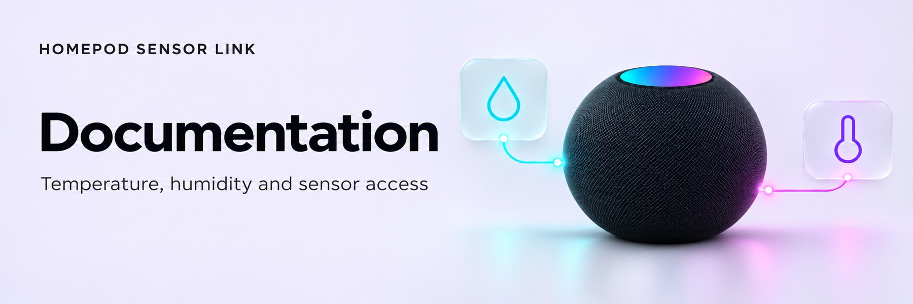

<!-- Generated by scripts/build_wiki.py; edit its source page. -->

<picture>
  <source media="(prefers-color-scheme: dark)" srcset="../docs/images/wiki/Home-dark.jpg">
  <source media="(prefers-color-scheme: light)" srcset="../docs/images/wiki/Home-light.jpg">
  
</picture>

# HomePod Sensor Link documentation

Discover HomePod temperature and humidity sensors, adopt existing native sensors, and manage dedicated sensor access with optional pairing recovery.

This Wiki is the reader-facing documentation for the experimental community integration. A HACS listing and supported hardware verification are not claimed. Requires Home Assistant 2026.10.0 or newer; the tested matrix is 2026.10.0 and 2026.11.0.

## Common tasks

| Task | Guide |
|---|---|
| Install, select devices and complete setup | [Getting started](Getting-Started.md) |
| Prepare explicitly authorised controller credentials | [Credential extraction](Credential-Extraction.md) |
| Understand sensors, diagnostics and actions | [Using the integration](Using-the-Integration.md) |
| Create alerts | [Automation examples](Automation-Examples.md) |
| Resolve pending setup or missing readings | [Troubleshooting](Troubleshooting-and-Support.md) |
| Check supported boundaries | [Known limitations](Known-Limitations.md) |
| Understand credential lifetime and removal | [Security](Security.md) |

## Development

- [Development environment](Development-Environment.md)
- [Architecture](Architecture.md)
- [Repository standards](Repository-Standards.md)

The [source repository](https://github.com/barneyonline/ha-homepod-sensor-link) retains the canonical documentation, technical evidence and changelog. For documentation updates, follow the [contribution guide](../CONTRIBUTING.md) and development guide. Wiki publication is explicit; CI does not write to the Wiki.
