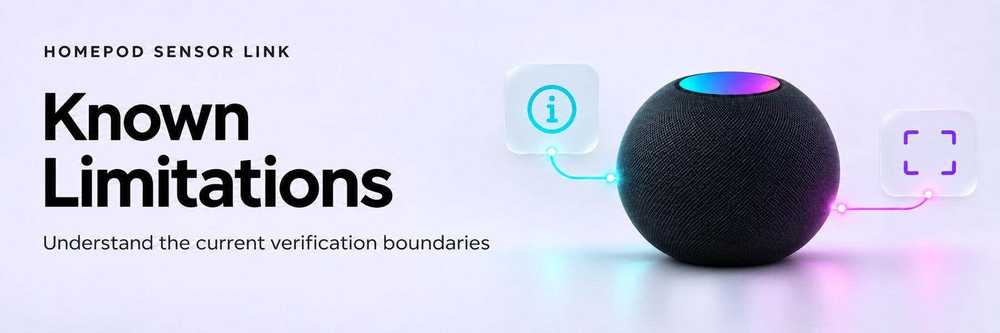

<!-- Generated by scripts/build_wiki.py; edit its source page. -->

<picture>
  <source media="(prefers-color-scheme: dark)" srcset="../docs/images/wiki/Known-Limitations-dark.jpg">
  <source media="(prefers-color-scheme: light)" srcset="../docs/images/wiki/Known-Limitations-light.jpg">
  
</picture>

# Known limitations and verification boundaries

- Apple documents temperature/humidity hardware for HomePod mini and HomePod (2nd generation), software 16.3+. This integration’s firmware interoperability and dedicated User access still require authorised real-device verification.
- The encrypted-iPhone-backup extraction guide is a source-researched candidate. Modern HomeKit record availability, exact identity association and intact export remain unproven. There is no implicit extraction or OS-protection workaround.
- Native HomeKit Device has no supported prepared-credential import in the tested HA versions. Existing native entries are adopted untouched; new measurements are owned by this integration.
- A dedicated User pairing reduces administrator authority but is not an accessory-enforced temperature-only capability.
- Local administrator HTTP import is allowed without an extra acknowledgement. HTTP does not encrypt credentials in transit. Existing HTTPS verification is never weakened.
- Only selected HomePods with verified pins and a readable unambiguous temperature/humidity layout can complete setup. A model name, discovery record or setup code is insufficient.
- One config entry manages multiple devices. Keys/identity pins cannot be silently rotated or replaced by Resume/re-import.
- Removal deletes local owned credentials and recovery history, but does not revoke on-device pairing records or erase backups/exports. No legacy transition or storage migration is provided.
- The existing GitHub initial commit is preserved and current files/index/reachable history can be audited. The earlier development baseline `2d5e069` was not supplied and remains unverified.
- Public source hosting does not establish HACS/brands acceptance, extraction proof, a release or real-device verification. Check GitHub Actions for hosted results. Local exact 100% Python/JavaScript coverage, strict typing and hassfest gates pass. Coverage does not verify hardware or award a quality tier; two external Platinum-target rules remain open.

See [validation evidence](Validation.md), [research](Research.md) and [completion boundary](Completion-Boundaries.md).
