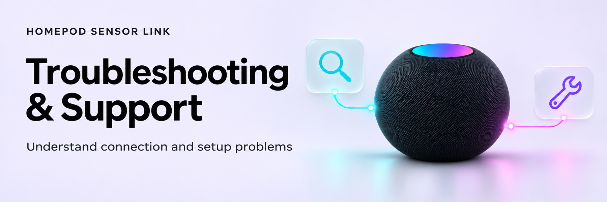

<!-- Generated by scripts/build_wiki.py; edit its source page. -->

<picture>
  <source media="(prefers-color-scheme: dark)" srcset="../docs/images/wiki/Troubleshooting-and-Support-dark.jpg">
  <source media="(prefers-color-scheme: light)" srcset="../docs/images/wiki/Troubleshooting-and-Support-light.jpg">
  
</picture>

# Troubleshooting and support

## Discovery shows no devices

Check that HA and the HomePods can exchange local HAP/mDNS traffic. A model advertisement is only a candidate; identity and temperature/humidity characteristics still need authentication. Do not disable firewall, certificate or OS protections as a workaround. Existing enabled native HomeKit entries are also candidates.

## Credential import is refused

Use an authenticated HA administrator on the local network. Cloud access and remote/wrong-user/expired import sessions are rejected before body bytes are read. Trusted proxies must preserve the real client address. Open a new import link if its ten-minute grant expired.

Import only selected HAP rows or the documented JSON/fields. A private controller seed requires its controller ID plus the accessory ID/public pin. A HomeKit setup code cannot replace them. Binary placeholders, unrelated password groups, inconsistent public/private keys, oversized exports and conflicting records are rejected. Do not post input data to an issue. The [extraction guide](Credential-Extraction.md) remains conditional on real-backup verification.

## Setup is pending after restart

The integration first checks the saved identity without writing. Select Reconfigure → Manage → Resume when ready to authorise another pending onboarding write. It reuses the same dedicated controller identity. An accepted pairing is inspected rather than blindly added again. Cancel keeps the setup paused. Ready devices continue independently.

## Recovery is waiting or blocked

| Condition | Meaning and next step |
|---|---|
| Network/discovery failure | Restore connectivity; these failures never authorise a pairing change |
| Startup grace or insufficient confirmed failures | Allow the normal five-minute checks to collect evidence |
| Hourly/daily attempt limit | Wait for the rolling window; repeated manual checks do not bypass it |
| Accepted pairing, publication/reload pending | Check measurement availability; persisted reload retries are bounded |
| Identity/key/permission mismatch | Investigate the exact device and imported identity; Resume cannot replace the pin |
| Competing recovery engine | Remove/disable the conflicting helper using its own supported process before using this one |

Do not remove/re-add the integration merely to evade a limit: removal deliberately deletes its credentials and recovery history and does not revoke on-device pairings.

## Readings are missing or unchanged

An unchanged numeric value can still be a fresh reading. Inspect completed check timestamps and diagnostic status. New sensor access is complete only after fresh authenticated values are published by both actual measurement entities. Existing adopted sensors retain native ownership; check that native entry’s status too.

## Reporting a problem

Record the integration version, HA version, HomePod model/software, whether sensors are native or integration-owned, recovery policy, controlled status/error category and steps to reproduce. Curated integration diagnostics use anonymous device ordinals, but review any attachment yourself before sharing.

Never attach keys, import files, backups, complete HA storage, addresses, controller/device IDs, household names, raw exceptions or unreviewed logs. No public support or private security endpoint exists yet. A security issue must wait for an agreed private reporting route; do not put it in a public issue. See [security](Security.md).
