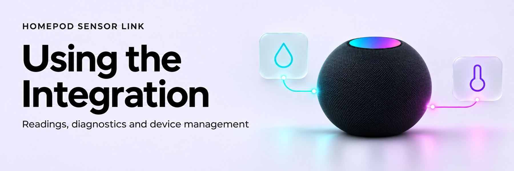

<!-- Generated by scripts/build_wiki.py; edit its source page. -->

<picture>
  <source media="(prefers-color-scheme: dark)" srcset="../docs/images/wiki/Using-the-Integration-dark.jpg">
  <source media="(prefers-color-scheme: light)" srcset="../docs/images/wiki/Using-the-Integration-light.jpg">
  
</picture>

# Using the integration

One integration entry manages one or more HomePods. Add or manage devices through Settings → Devices & services → HomePod Sensor Link → Reconfigure.

## Entities

| Entity | Purpose |
|---|---|
| Temperature | Fresh authenticated Celsius reading for a newly provisioned device |
| Humidity | Fresh authenticated relative humidity percentage for a newly provisioned device |
| Sensor access diagnostic | Current check/recovery state and completed-check timestamps |

Existing HomeKit Device temperature/humidity sensors remain owned by the native integration. Adoption adds monitoring without changing their IDs, unique IDs or history. New measurements belong to HomePod Sensor Link. Use the entity picker; generated entity IDs depend on the installation and names.

Measurements can stay constant while valid fresh reads continue. Use diagnostic `last_checked` to detect stalled checks rather than the temperature entity’s `last_changed`. A recent check can report a failure; heartbeat freshness does not prove healthy sensor access. Owned measurements become unavailable when setup is incomplete, access is blocked or their verified sample becomes stale.

## Actions

| Action | Behaviour |
|---|---|
| `homepod_sensor_link.check_now` | Run the normal check now; enabled recovery/pending setup/reloads remain subject to all safeguards |
| `homepod_sensor_link.check_recovery_access` | Perform a read-only administrator audit for recovery-enabled devices |

Both actions require a Home Assistant administrator. They remain listed when the integration is unloaded; unavailable runtime or operational failure returns a controlled translated error. Normal background checks run every five minutes. Do not schedule repeated checks to try to accelerate pairing repair.

## Device management

Recovery is on by default per selected device, but pairing writes require verified administrator credentials and persisted safety checks. Monitoring-only setup discards the imported administrator secret after successful sensor publication. Enabling recovery again requires a verified re-import.

Resume authorises a pending onboarding write after read-only checks; it cannot replace a pin or bypass limits for commissioned devices. Cancel pauses setup for that device. Pending devices do not prevent ready devices from working.

Removing a device deletes its owned credentials and recovery history. Removing the integration deletes all its owned credentials/history. Accessory pairing records remain on the HomePod; native sensors/history and unrelated storage remain untouched. See [setup](Getting-Started.md) and [security](Security.md).
